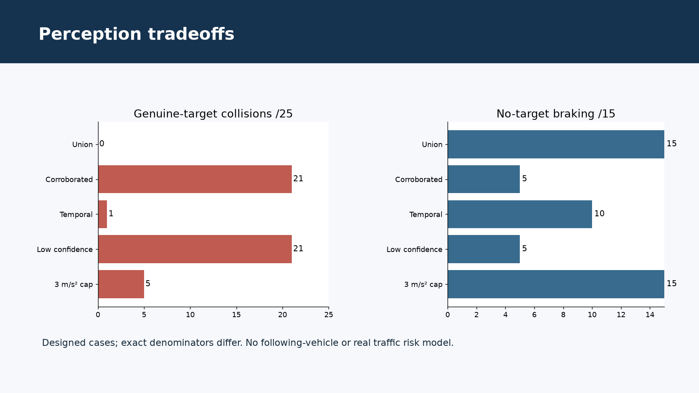
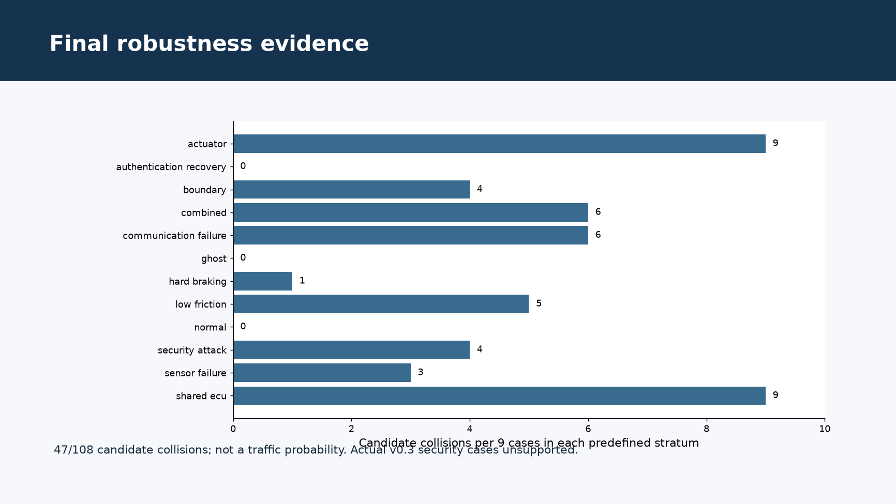

# AegisDrive-V v1.0.0

Integrated safety, security, MBSE and V-model engineering case study
Educational research; not a safe-vehicle certification claim

---

# System and trust boundary

C++ ADAS, Brake and Body ECUs; Python longitudinal SiL
Camera/radar fusion and shared physical actuator
64-byte CAN FD HMAC envelope; public test keys, trusted local clock/FFI

---

# Independent review scope

Same automation in separate reviewer roles, not accredited external assessment
Frozen v0.4 source/evidence; 92 baseline tests
846 non-host-timing outputs reproduced with zero mismatches

---

# Eighteen security collision timelines

Strict: 6 stale-delivery +4 counter-gap +2 rollback/replay
Recovery: the same 6 stale-delivery failures
All matched A cases avoid collision; withholding plus rejection/timeout removes braking

---

# Scoped engineering changes

Select newer authenticated producer time across valid transports
No raw/stale/replayed command bypass
Current-pressure observation and 100 ms clear-dwell recovery; native DTC stays latched

---

# Perception tradeoffs

Temporal filtering suppresses a brief ghost but persistent ghosts pass
Corroboration/confidence suppression can collide with genuine obstacles
3 m/s² cap can increase close-obstacle impact risk; study profiles are not default

---

# Final robustness evidence

108 predefined cases in 12 strata
Actual v0.3: 81 supported, 27 security cases unavailable
v0.4 and candidate: 47/108 collisions each; common 81-case comparison reported separately

---

# Verification and model limits

Requirement test status is separate from vehicle objective closure
Official SysML parse/semantic validation is not behavioral equivalence
Static analyzer and UBSan evidence; ASan runtime timeout, partial MC/DC retained

---

# Structured assurance case

Claims + evidence + assumptions + counterexamples
Legacy HARA/goal/requirement derivation gaps remain explicit
Passing tests do not close unsafe vehicle objectives

---

# Open issues and contribution

Shared ECU/actuator and security dependencies; trusted compromise
Ghosts, grip, ODD, short distance; no real follower/target WCET
Contribution: defensible decisions, reproducibility, traceable evidence and transparent risks
